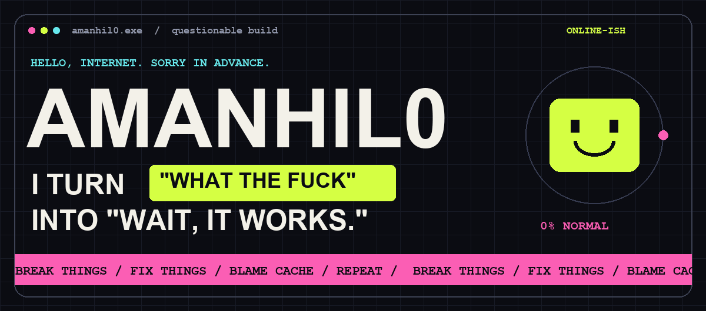
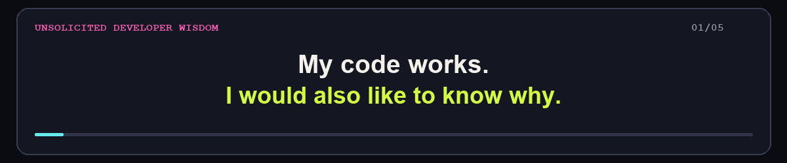
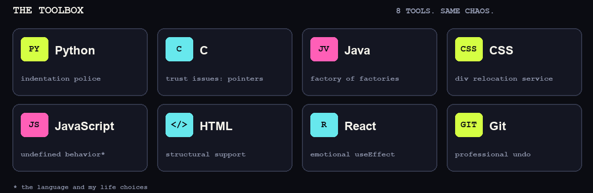

<p align="center">
  
</p>

<p align="center">
  <a href="https://github.com/amanhil0?tab=repositories"><b>🧪 OPEN THE LAB</b></a>
  &nbsp; × &nbsp;
  <a href="mailto:amanhil0000@gmail.com"><b>📡 REPORT A SIGHTING</b></a>
  &nbsp; × &nbsp;
  <a href="https://github.com/amanhil0?tab=stars"><b>🛸 STOLEN FROM THE INTERNET*</b></a>
  <br/><sub>*bookmarked. my lawyer said to clarify.</sub>
</p>

<h2 align="center">Aman Raj. Full-time human. Part-time syntax error.</h2>
<p align="center"><b>“Tomorrow I'll build something.”</b><br/>— me, several tomorrows ago</p>

<p align="center">
  
</p>

<p align="center">
  
</p>

<h2 align="center">🧠 BRAIN: 47 TABS OPEN. ONE IS PLAYING MUSIC.</h2>

```javascript
const aman = {
  languages: ["Python", "C", "Java", "JavaScript"],
  frontend:  ["HTML", "CSS", "React"],
  timeMachine: "Git",
  sleep: undefined,
  debugging: "negotiating with a machine I personally confused",
  nextBigThing: () => "give me one more tomorrow"
};
```

<h2 align="center">🧪 THINGS THAT ESCAPED localhost</h2>

<p align="center">
  <a href="https://github.com/amanhil0/HICIS"><b>HICIS ↗</b></a>
  &nbsp; / &nbsp;
  <a href="https://github.com/amanhil0/nitin"><b>nitin ↗</b></a>
  &nbsp; / &nbsp;
  <a href="https://github.com/amanhil0?tab=repositories"><b>THE ENTIRE CRIME SCENE ↗</b></a>
</p>

<p align="center"><i>“Every repository starts with ambition and a suspiciously empty README.”</i></p>

<details>
<summary><b>🔴 DO NOT PRESS THIS. YOU HAVE A PERFECTLY GOOD LIFE.</b></summary>

<br/>

```text
> running personality.exe

[OK] can write code
[OK] can break code
[OK] can write code that breaks other code
[??] can explain why it worked yesterday

FATAL: task completed successfully. this feels suspicious.
```

**You clicked a button explicitly telling you not to.**

Welcome to quality assurance. You start Monday.

</details>

<details>
<summary><b>🪦 OPEN THE COMMIT GRAVEYARD</b></summary>

<br/>

```text
fix
fix fix
actual fix
final fix
final fix 2
PLEASE
revert "PLEASE"
it was a missing semicolon
```

*Eight stages of grief. One line changed.*

</details>

<p align="center">
  <br/>
  <b>“If you think this profile is weird, you should see the commit history.”</b><br/><br/>
  <a href="mailto:amanhil0000@gmail.com">Got a ridiculous idea? Excellent. Send it.</a><br/>
  <sub>© amanhil0 · powered by curiosity and the audacity to click Run again</sub>
</p>

<!-- Secret achievement unlocked: reading the source of someone's personality. -->
