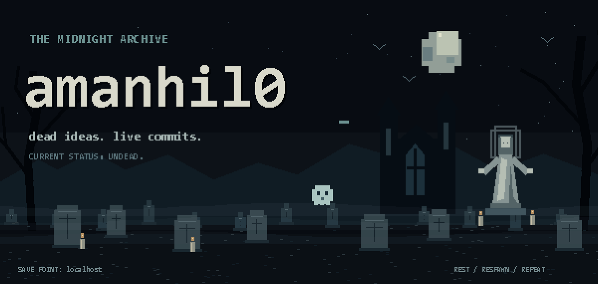
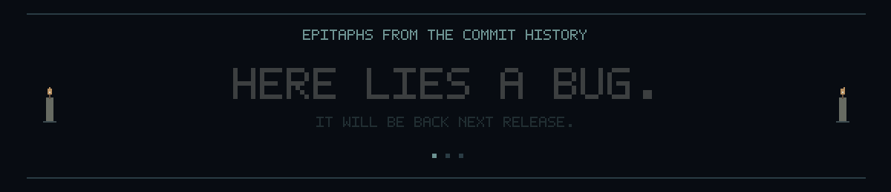
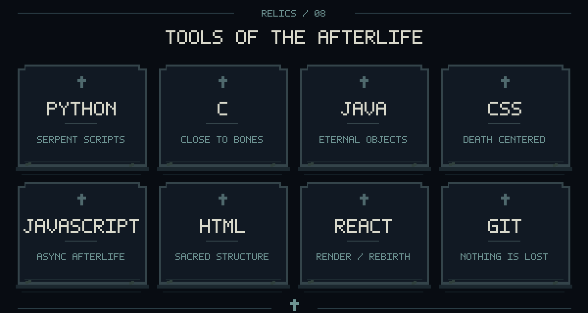
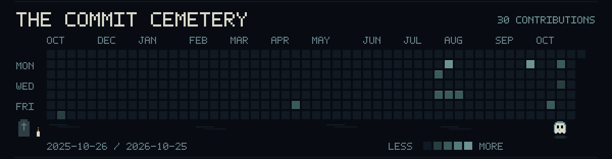

<p align="center">
  
</p>

<p align="center">
  <a href="https://github.com/amanhil0?tab=repositories">ENTER THE CRYPT</a>
  &nbsp; · &nbsp;
  <a href="https://github.com/amanhil0?tab=stars">UNEARTHED RELICS</a>
  &nbsp; · &nbsp;
  <a href="mailto:amanhil0000@gmail.com">SUMMON ME</a>
</p>

<p align="center">
  <b>Aman Raj</b><br/>
  <sub>Writing code. Raising exceptions. Occasionally raising the dead.</sub>
</p>

<p align="center">
  
</p>

<p align="center">
  
</p>

<p align="center">
  <a href="https://github.com/amanhil0?tab=overview">
    
  </a>
  <br/><sub>Real contributions. Restless spirits. Refreshed daily.</sub>
</p>

<h3 align="center">Unearthed from the crypt</h3>

<p align="center">
  <a href="https://github.com/amanhil0/HICIS"><b>HICIS ↗</b></a>
  &nbsp; / &nbsp;
  <a href="https://github.com/amanhil0/nitin"><b>nitin ↗</b></a>
  &nbsp; / &nbsp;
  <a href="https://github.com/amanhil0?tab=repositories"><b>ALL REPOSITORIES ↗</b></a>
  <br/><br/>
  <i>“My side projects aren't abandoned. They're in the afterlife.”</i>
</p>

<details>
<summary><b>＋ Disturb the commit graveyard</b></summary>

<br/>

```text
R.I.P.  "final fix"
        "final fix 2"
        "this one actually works"
        "revert that"
        "please"

Cause of death: one missing semicolon.
Last words:     "it worked yesterday."
```

*Nothing stays buried when you have version control.*

</details>

<p align="center">
  <br/>
  <code>REST. RESPAWN. REPEAT.</code><br/>
  <sub>If the code is haunted, that's a feature.</sub>
</p>

<!-- Secret room unlocked. The ghost has been expecting you. -->
